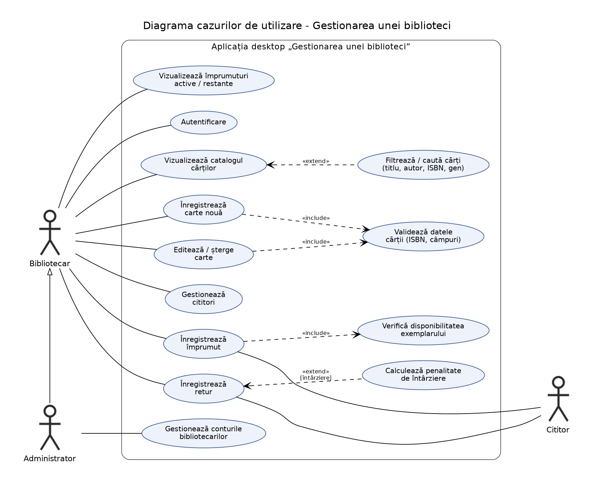
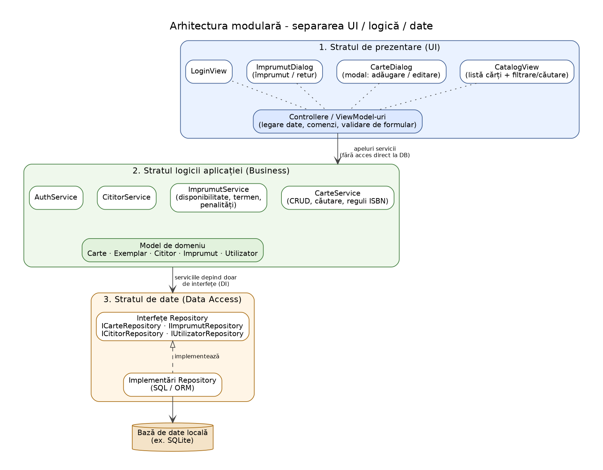

# Gestiune-Biblioteca-Desktop

Aplicație desktop pentru gestionarea unei biblioteci: evidența fondului de carte, a cititorilor și a împrumuturilor.

Momentan proiectul este în faza de proiectare (prototip UI, diagrame UML, arhitectură).

## Prototip Figma

Link: https://www.figma.com/proto/DE_COMPLETAT

Ecranele din prototip:
1. Catalogul cărților, cu căutare și filtre (gen, disponibilitate, an)
2. Fereastra modală pentru adăugarea unei cărți noi
3. Împrumut / Retur, cu calculul penalității de întârziere

Descrierea ecranelor și a legăturilor dintre ele este în [prototype/README.md](prototype/README.md). Exporturile PNG/PDF sunt în `prototype/export/`.

## Structura

```
docs/         descrierea cazurilor de utilizare și a arhitecturii
diagrams/     diagrama use case și schema arhitecturii (.dot + PNG/PDF)
prototype/    ecranele prototipului și exporturile din Figma
```

## Diagrama cazurilor de utilizare



Actori:
- Bibliotecar: folosește aplicația (catalog, cărți, cititori, împrumuturi, retururi)
- Administrator: la fel ca bibliotecarul, plus gestionarea conturilor
- Cititor: participă la împrumut și retur

Scenariile sunt descrise în [docs/cazuri-de-utilizare.md](docs/cazuri-de-utilizare.md).

## Arhitectura



Aplicația este împărțită pe 3 straturi:

- Interfața grafică (UI): ecranele și controllerele. Nu are acces direct la baza de date.
- Logica aplicației: serviciile (`CarteService`, `ImprumutService`, `CititorService`, `AuthService`) și regulile: validarea ISBN, disponibilitatea, termenele, penalitățile.
- Stratul de date: repository-uri accesate prin interfețe, cu o bază de date locală (SQLite).

Mai multe detalii în [docs/arhitectura.md](docs/arhitectura.md).

Diagramele sunt făcute cu Graphviz:

```bash
cd diagrams
dot -Tpng -Gdpi=130 use-case.dot -o use-case.png
dot -Tpng -Gdpi=130 arhitectura.dot -o arhitectura.png
```
