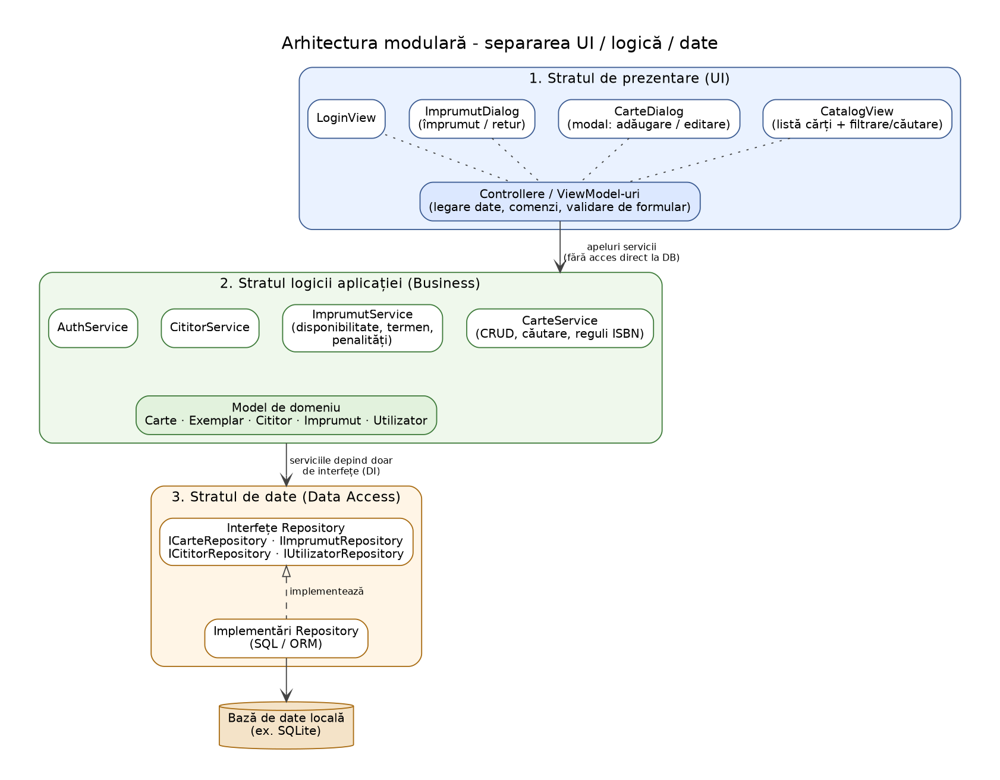

# Arhitectura modulară



Sursă: [`../diagrams/arhitectura.dot`](../diagrams/arhitectura.dot) · Export PDF: [`arhitectura.pdf`](../diagrams/arhitectura.pdf)

Aplicația folosește o arhitectură stratificată pe trei niveluri. Fiecare strat depinde numai de stratul imediat inferior, iar dependența către stratul de date trece prin interfețe.

## 1. Stratul de prezentare (UI)

Responsabilitate: afișarea datelor și preluarea acțiunilor utilizatorului. Nu conține reguli de business și nu accesează baza de date.

| Componentă | Ecran din prototip |
|---|---|
| `LoginView` | Autentificare |
| `CatalogView` | Catalogul principal: tabel cărți, bară de căutare, filtre |
| `CarteDialog` | Fereastra modală „Carte nouă” / „Editează carte” |
| `ImprumutDialog` | Fereastra „Împrumut / Retur” |
| Controllere / ViewModel-uri | Legarea datelor de controale, comenzi pentru butoane, validare de formular (câmpuri goale, format) |

## 2. Stratul logicii aplicației (Business)

Responsabilitate: regulile domeniului, independente de interfață și de modul de stocare.

- `CarteService`: adăugare/editare/ștergere, căutare și filtrare, validare ISBN, unicitate.
- `ImprumutService`: verifică disponibilitatea, aplică limita de împrumuturi per cititor, calculează data scadentă și penalitatea de întârziere.
- `CititorService`: evidența cititorilor.
- `AuthService`: autentificare și roluri (Bibliotecar / Administrator).
- Model de domeniu: `Carte`, `Exemplar`, `Cititor`, `Imprumut`, `Utilizator`.

## 3. Stratul de date (Data Access)

Responsabilitate: persistența.

- Interfețe Repository (`ICarteRepository`, `IImprumutRepository`, `ICititorRepository`, `IUtilizatorRepository`) definesc operațiile de citire/scriere.
- Implementările (SQL sau ORM) lucrează cu o bază de date locală, de exemplu SQLite, potrivită pentru o aplicație desktop fără server.
- Serviciile primesc repository-urile prin injecție de dependențe, așa că stocarea se poate înlocui (de exemplu cu un repository în memorie pentru teste) fără modificări în logica aplicației.

## Reguli de dependență

```
UI  ──►  Business  ──►  Interfețe Repository  ◄──  Implementări Repository  ──►  DB
```

- UI nu importă nimic din stratul de date.
- Business nu cunoaște controalele grafice și nici SQL-ul.
- Un ecran nou se adaugă în UI, o regulă nouă în Business, o schimbare de stocare în Data Access. Fiecare modificare rămâne izolată în stratul ei.

## Model de date (simplificat)

| Entitate | Câmpuri principale |
|---|---|
| `Carte` | id, isbn (unic), titlu, autor, editura, an, gen |
| `Exemplar` | id, carte_id, cod_inventar, stare (disponibil / împrumutat / pierdut) |
| `Cititor` | id, nr_legitimatie (unic), nume, prenume, telefon, email |
| `Imprumut` | id, exemplar_id, cititor_id, data_imprumut, data_scadenta, data_retur (nullable), penalitate |
| `Utilizator` | id, username, parola_hash, rol |
